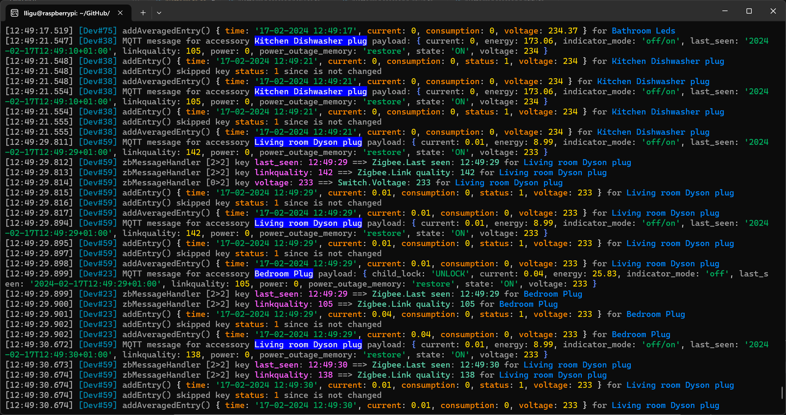

# Node ansi logger and stringify

[](https://www.npmjs.com/package/node-ansi-logger)
[](https://www.npmjs.com/package/node-ansi-logger)


[](https://codecov.io/gh/Luligu/node-ansi-logger)
[](https://vitest.dev)
[](https://oxc.rs/docs/guide/usage/formatter.html)
[](https://oxc.rs/docs/guide/usage/linter.html)
[](https://github.com/microsoft/typescript-go)
[](https://nodejs.org/)

---

AnsiLogger is a lightweight, customizable color logger for Node.js.

If you like this project and find it useful, please consider giving it a star on [GitHub](https://github.com/Luligu/node-ansi-logger) and sponsoring it.

<a href="https://www.buymeacoffee.com/luligugithub"></a>

## Features

- Simple and intuitive API for data logging.
- No dependencies.
- Customizable colors and apperance.
- Supports the NO_COLOR environment variable (https://no-color.org/): any non-empty value disables colors.
- It is also possible to pass a top level logger (like Homebridge or Matter logger) and AnsiLogger will use it
  for output instead of console.
- Includes also a fully customizable stringify funtion with colors (it is bigint aware and manage circular reference).
- Includes a chainable ANSI tagged template API (`ansi`) for styling terminal strings directly.
- Optional shared circular message cache with configurable capacity (default 200), snapshots, callback replay, and clearing.

## Getting Started

### Prerequisites

- Node.js 20.19.0 or later within 20.x, 22.13.0 or later within 22.x, 24.x, or 26.x.

### Installation

To get started with AnsiLogger in your package

```bash
npm install node-ansi-logger
```

# Usage

## Initializing AnsiLogger:

Create an instance of AnsiLogger.

```typescript
import { AnsiLogger, AnsiLoggerParams, LogLevel } from 'node-ansi-logger';
```

```typescript
const log = new AnsiLogger({ logName: '<your name>' }); // Eventually other params in AnsiLoggerParams
```

To import the stringify functions

```typescript
import { stringify, payloadStringify, colorStringify, mqttStringify, debugStringify } from 'node-ansi-logger';
```

## Using the logger:

```typescript
log.debug('Debug message...', ...parameters);
log.info('Info message...', ...parameters);
log.notice('Notice message...', ...parameters);
log.warn('Warning message', ...parameters);
log.error('Error message', ...parameters);
log.fatal('Fatal message', ...parameters);
log(LogLevel.WARN, 'Warning message', ...parameters);
```

## Using the logger with colors inside the message:

```typescript
log.debug(`Debug message ${YELLOW}with yellow part${db}`, ...);
```

## Caching and replaying messages

Set a shared cache to enable caching for all logger instances:

```typescript
import { AnsiLogger, AnsiLoggerCache } from 'node-ansi-logger';

const cache = new AnsiLoggerCache(); // Retains the latest 200 messages by default.
AnsiLogger.setGlobalCache(cache);

const log = new AnsiLogger({ logName: 'MyApp' });
log.info('Connected');

const messages = cache.get(); // [{ level: 'info', time: '...', name: 'MyApp', message: 'Connected' }]
const activeCache = AnsiLogger.getGlobalCache(); // Returns cache, or undefined when disabled.
cache.replay((entry) => {
  console.log(`[${entry.time}] [${entry.name}] [${entry.level}] ${entry.message}`);
});

cache.clear(); // Removes retained messages; caching remains enabled.
AnsiLogger.setGlobalCache(undefined); // Disables caching without clearing retained messages.
```

`setGlobalCache(cache)` returns the configured cache. Both static methods use
`globalThis.__AnsiLoggerCache__`, which can also be assigned directly.

Pass a positive safe integer to customize capacity, for example `new AnsiLoggerCache(500)`.
The circular buffer overwrites the oldest entry when full. Only messages allowed by each
logger's configured log level are cached, including messages routed to an external logger.
Additional parameters are joined with spaces, matching logger callbacks; message text and
ANSI codes are preserved. Existing console, file and callback output is unchanged.

`get()` returns independent copies in oldest-to-newest order. `replay(callback)` sends
the same structured entries to the callback from a snapshot without consuming the cache.
Messages added during replay are not included in that replay. Callback errors propagate
to the caller.

`clear()` empties the cache and resets the circular buffer without changing its capacity
or disabling caching. Existing snapshots returned by `get()` are unaffected.

## Using the logger internal timer:

```typescript
log.startTimer('Time sensitive code started');
log.stopTimer('Time sensitive code finished');
```

## Using the stringify function:

```typescript
stringify({...})
colorStringify({...})
```

## Using the ansi tagged template API:

Import the `ansi` root tag or individual named styles:

```typescript
import { bold, red, green, cyan, bgBlue, warn, error, fatal, hex, rgb, bgHex, bgRgb } from 'node-ansi-logger';
```

Apply a single style:

```typescript
console.log(red`Something went wrong`);
console.log(bold`Important message`);
```

Chain multiple styles:

```typescript
console.log(bold.red`Critical error`);
console.log(bgBlue.green`Green on blue`);
console.log(bold.italic.underline`Decorated text`);
```

Use dynamic RGB or hex colors:

```typescript
console.log(rgb(255, 128, 0)`Orange text`);
console.log(hex('#ff75d1').bold`Pink bold`);
console.log(bgRgb(30, 30, 30).cyan`Cyan on dark background`);
console.log(bgHex('#1a1a2e').white`White on dark blue`);
```

Nest styles — outer styles are automatically restored after inner resets:

```typescript
console.log(green`Connected ${bold.red`FAILED`} retrying...`);
console.log(warn`Server ${error.bold`crashed`} restarting`);
```

Use the 24-step grayscale ramp (`gray0` = darkest, `gray23` = lightest):

```typescript
import { gray0, gray8, gray13, gray20, gray23 } from 'node-ansi-logger';

console.log(gray0`Nearly black`);
console.log(gray8`Dark gray`);
console.log(gray13`Mid gray`);
console.log(gray20`Light gray`);
console.log(gray23`Nearly white`);
```

Log-level color exports:

```typescript
import { success, debug, info, notice, warn, error, fatal } from 'node-ansi-logger';

console.log(success`Operation completed`);
console.log(debug`Debug details`);
console.log(fatal`Unrecoverable error`);
```

Mix ansi styles inside AnsiLogger calls:

```typescript
import { AnsiLogger } from 'node-ansi-logger';
import { bold, red, green, cyan, yellow } from 'node-ansi-logger';

const log = new AnsiLogger({ logName: 'MyApp' });

log.info(`Device ${bold.cyan`Kitchen Light`} connected`);
log.warn(`Retry ${yellow`${3}`} of ${yellow`5`} — response timeout`);
log.error(`Failed to reach ${bold`192.168.1.10`}: ${red`connection refused`}`);
log.debug(`State changed: ${green`on`} → ${red`off`}`);
```

# Screenshot



## Development guide

Refer to the Matterbridge [Development guide](https://matterbridge.io/README-DEV.html) for other guidelines.

## Repository toolchain

See [TOOLCHAIN.md](./TOOLCHAIN.md) for compilers, linting, formatting, testing, and editor support.

## Shared agent instructions

See [SHARED-AGENTS.md](./SHARED-AGENTS.md) for shared guidance, rules, skills, and configuration for coding agents.

See [.agents/README.md](./.agents/README.md) for the shared instructions layout and versioning.

## Shared dev container support

See [.devcontainer/README.md](./.devcontainer/README.md) for the shared development container setup and usage.

## Contributing

See [CONTRIBUTING.md](./CONTRIBUTING.md) for contribution guidelines.

## Style guide

See [STYLEGUIDE.md](./STYLEGUIDE.md) for code style, naming, documentation, and testing conventions.

## Changelog

See [CHANGELOG.md](./CHANGELOG.md) for release history and notable changes.

## Issues and feature requests

Report bugs and suggest improvements on [GitHub Issues](https://github.com/Luligu/node-ansi-logger/issues).

## License

Licensed under the [Apache License 2.0](./LICENSE).

## Support the project

If you find this project useful, please consider giving it a star on [GitHub](https://github.com/Luligu/node-ansi-logger) and sponsoring it. Your support helps maintain and improve the project.

[](https://www.buymeacoffee.com/luligugithub)
